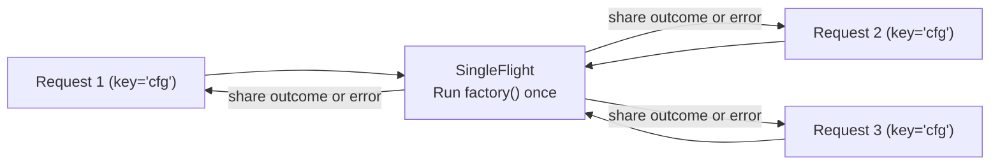

[← Documentation Map](README.md) · [Previous: 01 · Getting Started](getting-started.md) · [Next: 03 · Resilience: Retry, Circuit Breaker, and Cooldown →](resilience-and-recovery.md)

# 02 · Keyed Limiting and SingleFlight

This guide explains how `KeyedConcurrencyLimiter` and `KeyedRateLimiter` eliminate noisy-neighbor starvation, and how `SingleFlight` collapses thundering herds onto one shared execution.

---

## Table of Contents

- [Problem 1: Noisy Neighbors and Global Limit Traps](#problem-1-noisy-neighbors-and-global-limit-traps)
- [`KeyedConcurrencyLimiter` and `AsyncKeyedConcurrencyLimiter`](#keyedconcurrencylimiter-and-asynckeyedconcurrencylimiter)
- [`KeyedRateLimiter` and `AsyncKeyedRateLimiter` (Token Bucket)](#keyedratelimiter-and-asynckeyedratelimiter-token-bucket)
- [Problem 2: Cache Stampedes ("Thundering Herd")](#problem-2-cache-stampedes-thundering-herd)
- [`SingleFlight` and `AsyncSingleFlight`](#singleflight-and-asyncsingleflight)
- [Common Pitfalls](#common-pitfalls)

---

## Problem 1: Noisy Neighbors and Global Limit Traps

Protecting a multi-tenant service with a single global `asyncio.Semaphore(10)` lets one slow tenant (`tenant-A`) consume all 10 permits and stall every unrelated healthy tenant (`tenant-B`, `tenant-C`). Conversely, rolling your own `dict[str, Semaphore]` quickly leaks idle keys in memory or introduces deletion race conditions.

[Back to top](#table-of-contents)

---

## `KeyedConcurrencyLimiter` and `AsyncKeyedConcurrencyLimiter`

Enforces an independent concurrent permit cap (`max_concurrency`) per hashable key with **FIFO wakeup ordering** and automatic cleanup of idle keys:

- `with limiter.acquire(key, timeout=...)` / `async with limiter.acquire(key)` (wrap async acquire with `asyncio.wait_for` for timeouts).
- `acquire_nowait(key) -> bool`: Non-blocking permit grab (always pair a `True` return with `release(key)`).
- Inspect live counts via `stats()` and `key_stats(key)`.
- `close()` / `await aclose()` rejects further waiting cleanly.

```python
from flowcoord import KeyedConcurrencyLimiter

limiter = KeyedConcurrencyLimiter[str](2)  # Max 2 concurrent operations per key
with limiter.acquire("tenant-42", timeout=1.0):
    pass  # "tenant-99" proceeds immediately even if "tenant-42" is saturated
limiter.close()
```

[Back to top](#table-of-contents)

---

## `KeyedRateLimiter` and `AsyncKeyedRateLimiter` (Token Bucket)

When you need to limit **requests over time** rather than concurrent slots, use a monotonic token bucket:

- `KeyedRateLimiter(rate, period=1.0, burst=None, *, max_keys=4096, observer=None)`
  - Refills continuously at `rate / period` tokens per second up to `burst` (defaults to `rate`).
  - **`max_keys` memory guard:** Prevents random/adversarial keys from growing memory unboundedly. When full, expired/full-refilled buckets are pruned (`prune()`); if still saturated, new unknown keys are rejected.
- `try_acquire(key) -> bool` attempts immediate acquisition; `acquire(key, timeout=...)` / `await acquire(key)` waits until enough tokens accrue.

[Back to top](#table-of-contents)

---

## Problem 2: Cache Stampedes ("Thundering Herd")

When a hot cache entry expires under heavy traffic, 200 concurrent requests miss simultaneously and trigger 200 identical expensive database or upstream calls.

[Back to top](#table-of-contents)

---

## `SingleFlight` and `AsyncSingleFlight`

`SingleFlight` collapses concurrent calls for the same hashable key onto **one active execution**, sharing the resulting value or exception:



- If the leader raises an `Exception`, all joined callers receive it and the key is cleared immediately so subsequent callers can retry fresh.
- **`AsyncSingleFlight` cancellation safety:** Cancelling one waiter's `await sf.run(...)` does not break other joined waiters; supports `async aclose()`.

```python
import asyncio
from flowcoord import AsyncSingleFlight


async def main() -> None:
    sf = AsyncSingleFlight[str]()
    calls = 0

    async def load_expensive() -> int:
        nonlocal calls
        calls += 1
        await asyncio.sleep(0.02)
        return 99

    results = await asyncio.gather(*(sf.run("cfg", load_expensive) for _ in range(5)))
    await sf.aclose()

    assert results == [99, 99, 99, 99, 99]
    assert calls == 1  # Executed once despite 5 concurrent callers


asyncio.run(main())
```

[Back to top](#table-of-contents)

---

## Common Pitfalls

| Mistake | Risk | Fix |
| --- | --- | --- |
| Calling `acquire_nowait()` without a guaranteed `try/finally: release()` | Permanently leaks a key permit and deadlocks future waiters. | Prefer `with limiter.acquire(key):` / `async with limiter.acquire(key):`. |
| Using high-cardinality random request IDs in `KeyedRateLimiter` | Fills `max_keys` rapidly and rejects legitimate keys. | Key by bounded tenant/user/route identifiers and call `prune()` if needed. |
| Reusing identical keys across unrelated `SingleFlight` operations | Unrelated calls share wrong cached results. | Namespace keys cleanly, e.g. `("profile", user_id)`. |

[Back to top](#table-of-contents)

---

**Previous:** [01 · Getting Started and Architecture](getting-started.md) · **Next:** [03 · Resilience: Retry, Circuit Breaker, and Cooldown →](resilience-and-recovery.md)
