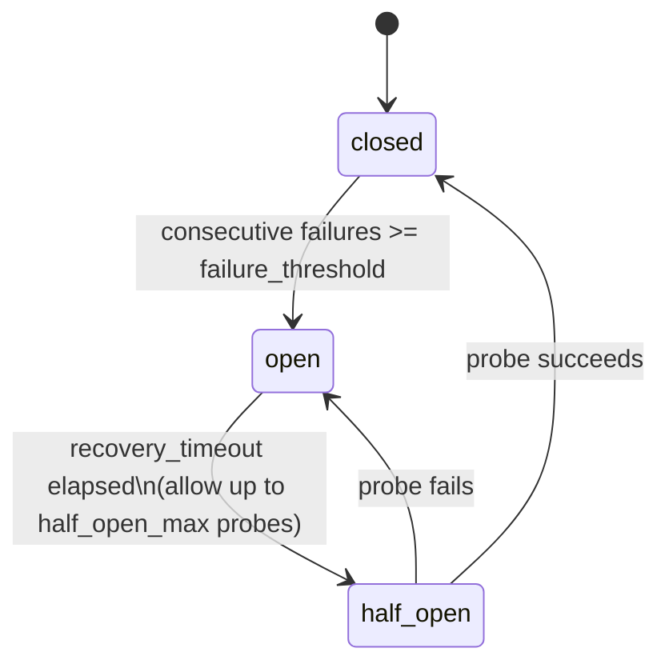

[← Documentation Map](README.md) · [Previous: 02 · Keyed Limiting and SingleFlight](concurrency-and-deduplication.md) · [Next: 04 · Tasks, Resource Scopes, Work Pool, and Portal →](tasks-scopes-and-portal.md)

# 03 · Resilience: Retry, Circuit Breaker, and Cooldown

This guide covers transient failure recovery (`RetryPolicy`), fail-fast circuit breaking (`CircuitBreaker`), per-key cooldown windows (`CooldownRegistry`), and how to layer them in the right order.

---

## Table of Contents

- [`RetryPolicy` and `AsyncRetryPolicy`](#retrypolicy-and-asyncretrypolicy)
  - [Why Backoff, Jitter, and `should_retry` Matter](#why-backoff-jitter-and-should_retry-matter)
  - [Bounding Total Time with `Deadline`](#bounding-total-time-with-deadline)
- [`CircuitBreaker` and `AsyncCircuitBreaker`](#circuitbreaker-and-asynccircuitbreaker)
  - [State Machine (`closed` → `open` → `half_open`)](#state-machine-closed--open--half_open)
- [`CooldownRegistry` and `AsyncCooldownRegistry`](#cooldownregistry-and-asynccooldownregistry)
- [Layering Order: `RetryPolicy` Outside vs Inside?](#layering-order-retrypolicy-outside-vs-inside)

---

## `RetryPolicy` and `AsyncRetryPolicy`

Retrying non-transient errors (such as `400 Bad Request` or `ValueError`) wastes time and load. Pair retry policies with an explicit `should_retry` predicate.

### Why Backoff, Jitter, and `should_retry` Matter

- **`max_attempts`** (default `3`): Total attempts including the initial try (`max_attempts=3` = 1 initial + 2 retries).
- **`backoff`**: `"exponential"` (`initial_delay * 2^(attempt-1)`) or `"fixed"` (`initial_delay`), clamped by `max_delay`.
- **`jitter`**: Adds randomized spread so thousands of disconnected clients do not retry at the exact same millisecond (avoiding retry storms).
- **`should_retry`**: Synchronous predicate returning `bool`; only exceptions returning `True` are retried.
- **`observer`**: Receives `RetryObservation(attempt, elapsed, status, error)` per attempt.

### Bounding Total Time with `Deadline`

Passing `deadline=budget` ensures the retry loop never sleeps past `budget.remaining`; if remaining budget is smaller than the scheduled backoff, retrying stops cleanly and re-raises the latest error.

[Back to top](#table-of-contents)

---

## `CircuitBreaker` and `AsyncCircuitBreaker`

Repeatedly waiting on timeouts against an already-down downstream service saturates your workers and triggers cascading failures. **`CircuitBreaker`** trips open quickly to let the dependency recover:

### State Machine (`closed` → `open` → `half_open`)



- **`closed`:** Calls pass through; consecutive exceptions matching `should_count` (defaults to all `Exception`s) increment the failure counter.
- **`open`:** Rejects calls immediately with **`CircuitOpenError`** without invoking the target.
- **`half_open`:** After `recovery_timeout`, allows at most `half_open_max` (default `1`) concurrent probe calls while still rejecting excess traffic with `CircuitOpenError`. A successful probe resets to `closed`.

```python
from flowcoord import CircuitBreaker, CircuitOpenError

breaker = CircuitBreaker(failure_threshold=2, recovery_timeout=5.0)
for _ in range(2):
    try:
        breaker.call(lambda: (_ for _ in ()).throw(ConnectionError("down")))
    except ConnectionError:
        pass

assert breaker.state == "open"
try:
    breaker.call(lambda: "skip")
except CircuitOpenError:
    pass  # Rejected immediately
```

[Back to top](#table-of-contents)

---

## `CooldownRegistry` and `AsyncCooldownRegistry`

When an upstream API returns `429 Retry-After` for one specific key/account/endpoint, pause only that key:

- `block(key, duration, *, extend=True) -> float`: Blocks `key` (`extend=True` prevents a shorter duration from shrinking an active longer cooldown).
- `is_blocked(key) -> bool` and `remaining(key) -> float`: Inspect active cooldowns.
- `wait(key, timeout=...)` / `await wait(key, timeout=...)`: Waits until cooldown expires (`True`) or timeout elapses (`False`).
- `clear(key)` / `prune()`: Clears a key early or drops expired entries (`max_entries=4096`).

[Back to top](#table-of-contents)

---

## Layering Order: `RetryPolicy` Outside vs Inside?

**Correct composition:**

`retry.run(lambda: breaker.call(operation), should_retry=lambda e: isinstance(e, (TimeoutError, ConnectionError)))`

1. **Place `RetryPolicy` outside `CircuitBreaker`.**
   - Each failed attempt increments the breaker immediately.
   - Once the breaker opens and raises `CircuitOpenError`, `should_retry` evaluates `False` and exits the retry loop immediately without sleeping.
2. Wrapping `retry.run` *inside* `breaker.call` hides 3 failed attempts as only 1 failure on the breaker, delaying protection.

[Back to top](#table-of-contents)

---

**Previous:** [02 · Keyed Limiting and SingleFlight](concurrency-and-deduplication.md) · **Next:** [04 · Tasks, Resource Scopes, Work Pool, and Portal →](tasks-scopes-and-portal.md)
