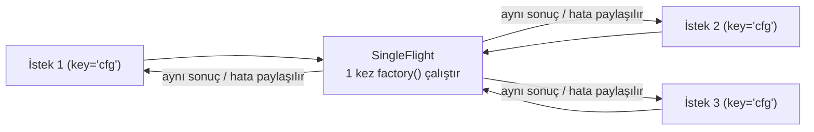

[← Belge Haritası](README.md) · [Önceki: 01 · Başlangıç](getting-started.md) · [Sonraki: 03 · Dayanıklılık: Retry, Circuit Breaker ve Cooldown →](resilience-and-recovery.md)

# 02 · Anahtar Bazlı Sınırlama ve SingleFlight

Bu rehber çok kiracılı (multi-tenant) sistemlerde gürültülü komşu sorununu önleyen `KeyedConcurrencyLimiter` ve `KeyedRateLimiter` ile "cache stampede / thundering herd" yükünü tek çalışmaya indiren `SingleFlight` bileşenlerini anlatır.

---

## Konu Dizini

- [Problem 1: Gürültülü Komşu ("Noisy Neighbor") ve Küresel Limit Tuzağı](#problem-1-gürültülü-komşu-noisy-neighbor-ve-küresel-limit-tuzağı)
- [`KeyedConcurrencyLimiter` ve `AsyncKeyedConcurrencyLimiter`](#keyedconcurrencylimiter-ve-asynckeyedconcurrencylimiter)
- [`KeyedRateLimiter` ve `AsyncKeyedRateLimiter` (Token Bucket)](#keyedratelimiter-ve-asynckeyedratelimiter-token-bucket)
- [Problem 2: Cache Stampede ("Thundering Herd")](#problem-2-cache-stampede-thundering-herd)
- [`SingleFlight` ve `AsyncSingleFlight`](#singleflight-ve-asyncsingleflight)
- [Sık Yapılan Hatalar](#sık-yapılan-hatalar)

---

## Problem 1: Gürültülü Komşu ("Noisy Neighbor") ve Küresel Limit Tuzağı

Bir hizmette `asyncio.Semaphore(10)` gibi **tek bir global limit** koyduğunda, `tenant-A` aynı anda 10 yavaş istek açarsa tüm diğer sağlıklı müşteriler (`tenant-B`, `tenant-C`) sebepsiz yere beklemeye düşer. Her tenant için sözlükte (`dict[str, Semaphore]`) elle semafor tutmaya çalışırsan da boşalan anahtarların bellekte sonsuza kadar birikmesi (memory leak) ve silme sırasında lock yarışı çıkar.

[Yukarı dön](#konu-dizini)

---

## `KeyedConcurrencyLimiter` ve `AsyncKeyedConcurrencyLimiter`

Her anahtar için eşzamanlı aktif işlem sayısını (`max_concurrency`) bağımsız sınırlar; bekleyenler her anahtar içinde **FIFO sırasıyla** uyanır ve işi biten boş anahtarlar güvenle temizlenir:

- `with limiter.acquire(key, timeout=...)` / `async with limiter.acquire(key)` (asenkron sürümde dış `asyncio.wait_for(..., timeout)` ile kullanılabilir).
- `acquire_nowait(key) -> bool`: Beklemeden izin almaya çalışır; almışsa mutlaka eşleşen `release(key)` çağrılmalıdır.
- `stats()` ve `key_stats(key)` ile anlık aktif çalışan ve bekleyen sayılarını okuyabilirsin.
- `close()` / `await aclose()` kapanış sonrasında bekleyen yeni talepleri kapatır.

```python
from flowcoord import KeyedConcurrencyLimiter

limiter = KeyedConcurrencyLimiter[str](2)  # Anahtar başına en fazla 2 eşzamanlı iş
with limiter.acquire("tenant-42", timeout=1.0):
    pass  # "tenant-42" kilitliyken "tenant-99" hiç beklemeden ilerler
limiter.close()
```

[Yukarı dön](#konu-dizini)

---

## `KeyedRateLimiter` ve `AsyncKeyedRateLimiter` (Token Bucket)

Eşzamanlılık ("aynı anda kaç iş?") yerine **zaman penceresi içindeki hız** ("saniyede / dakikada kaç istek?") kontrol edilmek istendiğinde token bucket algoritması gerekir:

- `KeyedRateLimiter(rate, period=1.0, burst=None, *, max_keys=4096, observer=None)`
  - `rate / period` hızında monotonik saatle token dolar; anlık sıçramalar `burst` (varsayılan `rate`) ile sınırlanır.
  - **`max_keys` bellek koruması:** Saldırı veya rastgele UUID'li anahtarlar geldiğinde sözlüğün sınırsız büyüyüp RAM doldurmasını engeller. Sınır dolduğunda süresi dolmuş boş kovaları temizler (`prune()`); hala doluysa yeni anahtarı reddeder.
- `try_acquire(key) -> bool`: Beklemeden token alır veya `False` döner.
- `acquire(key, timeout=...)` / `await acquire(key)`: Yeterli token oluşana kadar bekler.

[Yukarı dön](#konu-dizini)

---

## Problem 2: Cache Stampede ("Thundering Herd")

Popüler bir önbellek kaydı (ör. ana sayfa yapılandırması veya JWKS anahtarı) tam düştüğü anda 200 eşzamanlı istek aynı anahtarı (`"config:v1"`) okursa, hepsi cache miss görüp aynı ağır veritabanı sorgusunu **200 kere aynı anda** ateşler.

[Yukarı dön](#konu-dizini)

---

## `SingleFlight` ve `AsyncSingleFlight`

`SingleFlight`, **aynı anahtar için halihazırda uçuşta (`in-flight`) olan çağrı varsa ikinci bir iş başlatmaz**; gelen diğer tüm çağıranları o ilk işin sonucuna bağlar:



- Lider çağrı bir `Exception` yükseltirse paylaşılan istisna tüm bekleyenlere de iletilir ve anahtar hemen serbest bırakılır (sonraki yeni istek sıfırdan deneyebilir).
- **`AsyncSingleFlight` iptal güvenliği:** Bir bekleyen task kendi `await sf.run(...)` çağrısını iptal ederse liderin çalışmasını hemen çökertmez; paylaşılan işi yönetir ve asenkron `aclose()` kapanışını destekler.

```python
import asyncio
from flowcoord import AsyncSingleFlight


async def main() -> None:
    sf = AsyncSingleFlight[str]()
    calls = 0

    async def load_expensive() -> int:
        nonlocal calls
        calls += 1
        await asyncio.sleep(0.02)
        return 99

    results = await asyncio.gather(*(sf.run("cfg", load_expensive) for _ in range(5)))
    await sf.aclose()

    assert results == [99, 99, 99, 99, 99]
    assert calls == 1  # 5 eşzamanlı çağrıya rağmen yalnızca 1 kez çalıştı


asyncio.run(main())
```

[Yukarı dön](#konu-dizini)

---

## Sık Yapılan Hatalar

| Hata | Neden Risklidir? | Doğrusu |
| --- | --- | --- |
| `acquire_nowait()` başarılı olduktan sonra `try/finally` içinde `release()` çağırmamak | O anahtar için izin sızıntısı oluşur ve sonraki bekleyenler kilitlenir. | Mümkünse bağlam yöneticisi (`with` / `async with limiter.acquire(key):`) kullan. |
| Rate limiter içine `max_keys` sınırı gözetmeden sınırsız rastgele key göndermek | Yeni anahtarlar kapasiteyi doldurup reddedilebilir. | `key` kardinalitesini makul seviyede tut (ör. `user_id` veya `tenant_id`, rastgele `request_id` değil) ve gerekirse `prune()` kullan. |
| Farklı işler için aynı `SingleFlight` anahtarını vermek | İlgisiz iki çağrı birbirinin sonucunu paylaşmış olur. | Anahtara işlem + kimlik bilgisini ekle (ör. `("profile", user_id)`). |

[Yukarı dön](#konu-dizini)

---

**Önceki:** [01 · Başlangıç ve Mimari Felsefe](getting-started.md) · **Sonraki:** [03 · Dayanıklılık: Retry, Circuit Breaker ve Cooldown →](resilience-and-recovery.md)
