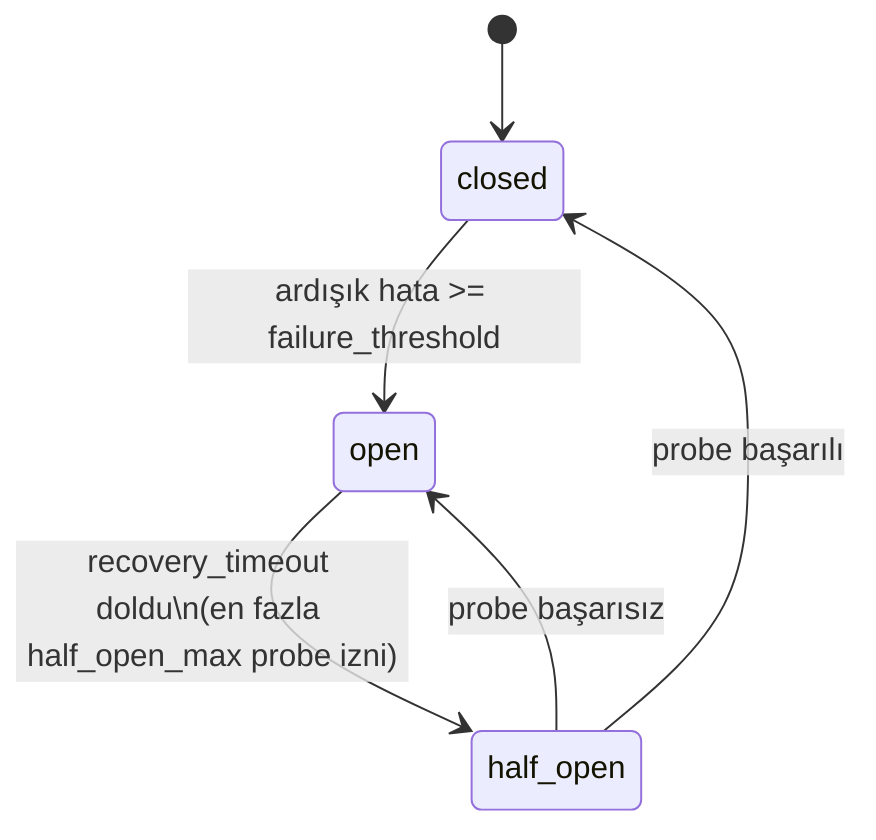

[← Belge Haritası](README.md) · [Önceki: 02 · Sınırlama ve SingleFlight](concurrency-and-deduplication.md) · [Sonraki: 04 · Görev Sahipliği ve Portal →](tasks-scopes-and-portal.md)

# 03 · Dayanıklılık: Retry, Circuit Breaker ve Cooldown

Bu rehber geçici ağ hatalarını toparlamak (`RetryPolicy`), çöken bağımlılıklara yük bindirmeyi kesmek (`CircuitBreaker`) ve anahtar bazlı soğuma pencereleri yönetmek (`CooldownRegistry`) için gereken mimari kuralları açıklar.

---

## Konu Dizini

- [`RetryPolicy` ve `AsyncRetryPolicy`](#retrypolicy-ve-asyncretrypolicy)
  - [Backoff, Jitter ve `should_retry` Neden Gereklidir?](#backoff-jitter-ve-should_retry-neden-gereklidir)
  - [`Deadline` ile Toplam Süre Sınırlama](#deadline-ile-toplam-süre-sınırlama)
- [`CircuitBreaker` ve `AsyncCircuitBreaker`](#circuitbreaker-ve-asynccircuitbreaker)
  - [Durum Makinesi (`closed` → `open` → `half_open`)](#durum-makinesi-closed--open--half_open)
- [`CooldownRegistry` ve `AsyncCooldownRegistry`](#cooldownregistry-ve-asynccooldownregistry)
- [Doğru Birleştirme Sırası: `RetryPolicy` Dışta mı İçte mi?](#doğru-birleştirme-sırası-retrypolicy-dışta-mı-i%CC%87çte-mi)

---

## `RetryPolicy` ve `AsyncRetryPolicy`

Her hata yeniden denenmez. Örneğin `ValueError` veya `400 Bad Request` hatasını 3 kez yeniden denemek yalnızca gecikmeyi artırır; oysa `TimeoutError` veya geçici bağlantı kesintisi yeniden denenebilir.

### Backoff, Jitter ve `should_retry` Neden Gereklidir?

- **`max_attempts`** (varsayılan `3`): İlk deneme dahil toplam deneme sayısıdır (`max_attempts=3` → 1 asıl + 2 yeniden deneme).
- **`backoff`**: `"exponential"` (`initial_delay * 2^(attempt-1)`) veya `"fixed"` (`initial_delay`), her zaman `max_delay` ile üstten sınırlıdır.
- **`jitter` (`0.0..1.0` veya bekleme katsayısı):** Aynı anda kopan 1000 istemcinin `1s -> 2s -> 4s` anlarında tekrar **aynı milisaniyede** sunucuya vurmasını (retry storm) dağıtmak için rastgele gürültü ekler.
- **`should_retry`:** Yalnızca geçici olduğu bilinen hatalarda `True` döndürmelidir (senkron `bool` şarttır).
- **`observer`:** Her deneme sonunda `RetryObservation(attempt, elapsed, status, error)` bildirir.

### `Deadline` ile Toplam Süre Sınırlama

`deadline`, yeni denemenin ne zaman başlayabileceğini sınırlar ve beklemeyi kalan bütçeyle kısıtlar. Başlamış bir işlemi kesmez. Gerekirse işlemin kendi zaman aşımını ayrıca ayarla.

[Yukarı dön](#konu-dizini)

---

## `CircuitBreaker` ve `AsyncCircuitBreaker`

Çökmüş bir veritabanına veya ödeme API'sine her istekte `timeout` süresi (ör. 10 saniye) boyunca bekleyip retry yapmak sistemin tüm worker thread/task havuzunu kilitler (cascading failure). **`CircuitBreaker`**, bağımlılık sağlığını izleyen bir durum makinesiyle çöken bağımlılığı kısa süreliğine izole eder:

### Durum Makinesi (`closed` → `open` → `half_open`)



- **`closed`:** Tüm çağrılar geçer. `should_count(error)` (varsayılan tüm `Exception`'lar) `True` döndürdükçe ardışık hata sayacı artar.
- **`open`:** Çağrılar hedef fonksiyona hiç gönderilmeden anında **`CircuitOpenError`** ile reddedilir (`rejected` artar).
- **`half_open`:** `recovery_timeout` geçtikten sonra sistemi test etmek için yalnızca `half_open_max` (varsayılan `1`) adet "probe" isteğe izin verilir; eşzamanlı diğer istekler yine `CircuitOpenError` ile reddedilir. Probe başarıyla dönerse devre yeniden `closed` olur.

```python
from flowcoord import CircuitBreaker, CircuitOpenError

breaker = CircuitBreaker(failure_threshold=2, recovery_timeout=5.0)
for _ in range(2):
    try:
        breaker.call(lambda: (_ for _ in ()).throw(ConnectionError("down")))
    except ConnectionError:
        pass

assert breaker.state == "open"
try:
    breaker.call(lambda: "skip")
except CircuitOpenError:
    pass  # Anında reddedildi
```

[Yukarı dön](#konu-dizini)

---

## `CooldownRegistry` ve `AsyncCooldownRegistry`

Bir API belirli bir anahtar için `429 Retry-After: 30s` veya geçici blok döndürdüğünde, yalnızca o anahtarın belirli süre bekletilmesi gerekir:

- `block(key, duration, *, extend=True) -> float`: Anahtarı `duration` saniye bloklar (`extend=True` mevcut süreden kısa olan blokların ömrü kısaltmasını engeller).
- `is_blocked(key) -> bool` ve `remaining(key) -> float`: Blok durumu ve kalan saniyeyi verir.
- `wait(key, timeout=...)` / `await wait(key, timeout=...)`: Blok kalkana kadar bekler; `True` (blok açıldı) veya `False` (timeout doldu) döndürür.
- `clear(key)` / `prune()`: Bloğu erken kaldırır veya süresi biten kayıtları temizler (`max_entries` varsayılan `4096`).

[Yukarı dön](#konu-dizini)

---

## Doğru Birleştirme Sırası: `RetryPolicy` Dışta mı İçte mi?

**Doğru katmanlama:**

`retry.run(lambda: breaker.call(operation), should_retry=lambda e: isinstance(e, (TimeoutError, ConnectionError)))`

1. **`RetryPolicy` dışta, `CircuitBreaker` içte olmalıdır.**
   - Böylece `operation()` her çöktüğünde `CircuitBreaker` sayacı her denemede artar.
   - Eşik aşılıp devre açıldığında (`CircuitOpenError`), `should_retry` `CircuitOpenError`'ı yeniden denemeyeceği için retry döngüsü boşuna beklemeden hemen durur.
2. Tersini (`breaker.call(lambda: retry.run(...))`) yaparsan tek bir kullanıcı çağrısı içinde 3 başarısız deneme tek hata gibi sayılır ve sistem arızayı geç fark eder.

[Yukarı dön](#konu-dizini)

---

**Önceki:** [02 · Anahtar Bazlı Sınırlama ve SingleFlight](concurrency-and-deduplication.md) · **Sonraki:** [04 · Görev Sahipliği, Kaynak Scope'ları ve Portal →](tasks-scopes-and-portal.md)
